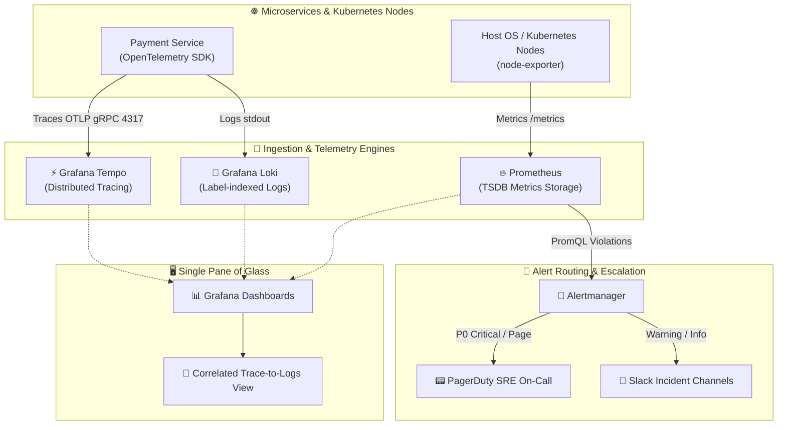

# 📊 End-to-End Enterprise Observability & Monitoring Platform

[](https://github.com/shyam-codeops/observability-monitoring-stack/actions)
[](https://prometheus.io)
[](https://grafana.com)
[](https://grafana.com/oss/loki/)
[](https://grafana.com/oss/tempo/)
[](LICENSE)

A production-grade, full-stack **Observability & Monitoring platform** uniting the three fundamental pillars of observability: **Metrics (Prometheus)**, **Logs (Loki)**, and **Traces (Tempo)**, unified through automated **Grafana** provisioning and **Alertmanager** incident escalation trees. Includes pre-configured **Google SRE multiwindow multi-burn-rate SLO alerting** and full cluster health dashboards.

---

## 🏛️ Observability Architecture & Correlation



---

## 💎 Production Capabilities

| Component | Responsibility | Highlighted Feature |
| :--- | :--- | :--- |
| **🔥 Prometheus** | Metrics collection & PromQL calculation. | 15s scrape interval, out-of-the-box node-exporter, and cAdvisor rules. |
| **🚨 SRE SLO Burn Rates** | Multi-window burn rate alert formulas. | Implements Google SRE Workbook burn-rate alerts (detects 14.4x burn rate over 1h before error budget exhausts). |
| **📊 Grafana** | Automated visualization & dashboards. | Auto-provisioned datasources and dashboards (`kubernetes-cluster-overview.json`) with availability gauges. |
| **📑 Grafana Loki** | Cost-effective log aggregation. | LogQL querying without high-cardinality indexing overhead. |
| **⚡ Grafana Tempo** | High-scale distributed tracing. | Correlates distributed trace IDs directly to relevant application logs in Loki. |
| **🔔 Alertmanager** | Alert grouping, deduplication & routing. | Inhibition rules (silences duplicate warnings when critical alerts fire) and PagerDuty escalation trees. |

---

## 📁 Repository Structure

```tree
observability-monitoring-stack/
├── .github/
│   └── workflows/
│       └── ci.yml                 # Automated config validation CI
├── alertmanager/
│   └── alertmanager.yml           # Routing rules, inhibition, Slack/PagerDuty
├── prometheus/
│   ├── prometheus.yml             # Scrape jobs & Alertmanager targets
│   └── rules/
│       └── alerts.yaml            # PromQL CPU, Memory, CrashLoop, and SLO alerts
├── grafana/
│   ├── dashboards/
│   │   └── kubernetes-cluster-overview.json # Pre-built SRE SLO dashboard
│   └── provisioning/
│       ├── dashboards/
│       │   └── dashboards.yaml    # Auto-dashboard loader
│       └── datasources/
│           └── datasources.yaml   # Prometheus, Loki, Tempo correlation
├── tempo/
│   └── tempo.yaml                 # OTLP gRPC trace distributor config
├── tests/
│   ├── __init__.py
│   └── test_observability.py      # Automated unit tests
├── docker-compose.yml             # Single-command local deployment
├── .gitignore
├── LICENSE
└── README.md
```

---

## 🚀 Quickstart & Local Lab

### 1. Run Automated Test Suite (Zero External Dependencies)
Validate Prometheus rules, Alertmanager routing, and Grafana dashboard JSON integrity:

```bash
git clone https://github.com/shyam-codeops/observability-monitoring-stack.git
cd observability-monitoring-stack

python -m unittest discover -s tests -p "test_*.py" -v
```

### 2. Launch Local Observability Stack with Docker Compose
Start the complete observability lab in the background:

```bash
docker compose up -d
```

### 3. Access Pre-Configured Endpoints

| Service | Port | Default Credentials | Description |
| :--- | :--- | :--- | :--- |
| **Grafana** | `http://localhost:3000` | `admin` / `admin` | Unified visualization dashboards |
| **Prometheus** | `http://localhost:9090` | None | Metric exploration & PromQL targets |
| **Alertmanager** | `http://localhost:9093` | None | Active alert status & silences |
| **Loki** | `http://localhost:3100` | None | Log ingestion HTTP API |
| **Tempo** | `http://localhost:3200` | None | Trace receiver (OTLP gRPC on 4317) |
| **Node Exporter** | `http://localhost:9100` | None | Host hardware & OS metrics |

---

## 🎯 SRE SLO & Error Budget Alerting

This stack includes advanced **Multiwindow Multi-Burn-Rate Alerts** based on the Google SRE framework:

```yaml
- alert: SloErrorBudgetRapidBurn
  expr: (sum(rate(http_requests_total{status=~"5.*"}[1h])) / sum(rate(http_requests_total[1h]))) > (14.4 * (1 - 0.999))
  for: 2m
  labels:
    severity: page
    tier: sre
```

* **Target Availability**: 99.9% uptime (0.1% error budget over 30 days)
* **Burn Rate**: 14.4x consumes 2% of budget in 1 hour
* **Action**: Automatically notifies PagerDuty before users experience noticeable outage duration.

---

## 👤 Author

**Shyam Singh**
* GitHub: [@shyam-codeops](https://github.com/shyam-codeops)
* Role: DevOps Engineer

---

## 📄 License
This project is licensed under the MIT License - see the [LICENSE](LICENSE) file for details.
